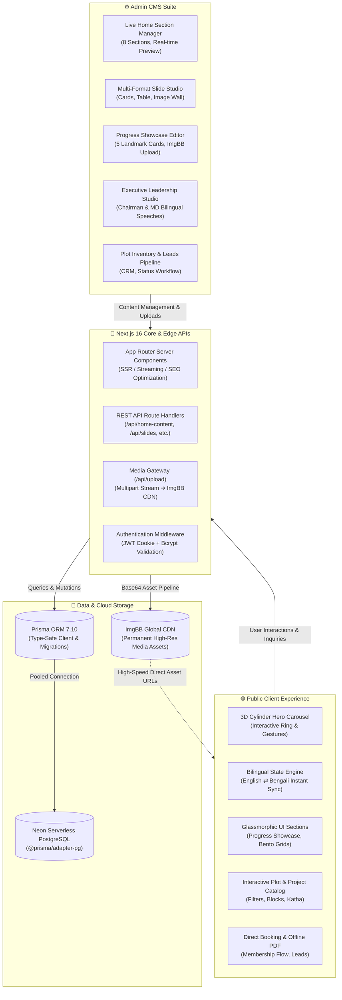

# Silicon Real Estate (Pvt.) Ltd. — Silicon City Mega Township Platform

### **Next-Generation Enterprise Real Estate Platform & Headless CMS**
*Planned Eco-Township • 150+ Acres • Savar, Dhaka (15 Mins from Mohammadpur)*

[Live Demo](#) • [Admin Portal](#admin-cms-ecosystem) • [Architecture](#-system-architecture--ecosystem) • [API Docs](#-rest-api-reference) • [Setup Guide](#-installation--setup)

---

## 🌐 Executive Overview

**Silicon Real Estate (Pvt.) Ltd.** is a flagship real estate platform engineered for **Silicon City**, a master-planned mega township located at Bara Badeshi Mouza, Savar, Dhaka — positioned along the scenic Turag River and directly connected to the Mohammadpur Beribadh. 

The platform delivers an enterprise-grade, high-performance web experience featuring a **3D cylindrical carousel hero**, dynamic glassmorphic data grids, bilingual localization (**English & Bengali**), and a dedicated **No-Code Administrative CMS** powered by **Neon Serverless PostgreSQL** and **Prisma ORM**.

---

## 🏛 System Architecture & Ecosystem

The platform follows a modern full-stack decoupled architecture running on the **Next.js 16 App Router**:

---

## ✨ Core Ecosystem Highlights

### 1. 🌟 Public Portal Experience (12 Dedicated Modules)

| # | Section Name | Key Visual Feature | Data Source |
|---|---|---|---|
| **01** | **3D Cylinder Hero Carousel** | Perspective 3D rotating ring with mouse drag, keyboard arrows, and auto-orbiting slide decks | Dynamic `Slide` Model |
| **02** | **Master Plan & Amenities** | Layout architecture, 30ft & 40ft avenues, sunlight zoning, central eco-spaces | `HomeContent.masterPlan*` |
| **03** | **Live Database Plot Showcase** | Handpicked verified plots with Katha badges, Block tags, pricing, and direct detail links | `Property` Model |
| **04** | **Why Choose Us Bento Grid** | 16–18ft sand elevation, 100% mutation ready, RAJUK alignment, 15 min proximity | Bento Card Grid |
| **05** | **Flagship Township Spotlight** | Turag riverfront panorama, flood protection embankment, and master zoning | `HomeContent.showcase*` |
| **06** | **On-Ground Progress Showcase** | 5 interactive landmark cards (Central Mosque, Eco Park, Sports Complex, Healthcare, Boulevard) | `sectionsConfig.galleryItems` |
| **07** | **4-Step Acquisition Process** | Physical site visit, plot demarcation, transparent registration, milestone handover | Interactive Process Steps |
| **08** | **Proven Track Record Counters** | 150+ Acres, 16–18ft Elevation, 30/40ft Concrete Roads, 100% Ready Mutation | `HomeContent.trustCounters` |
| **09** | **Executive Leadership Statements** | Chairman & Managing Director speeches with high-res portraits, fallback avatar badges | `sectionsConfig.executive` |
| **10** | **Regulatory Accreditations** | Official compliance badges: RAJUK Master Plan, Flood Embankment Zone, CS/SA/RS/BS Khatiyan | `HomeContent.accreditations` |
| **11** | **Dynamic Company Press & News** | Editorial articles, handover announcements, and infrastructure updates | `BlogPost` Model |
