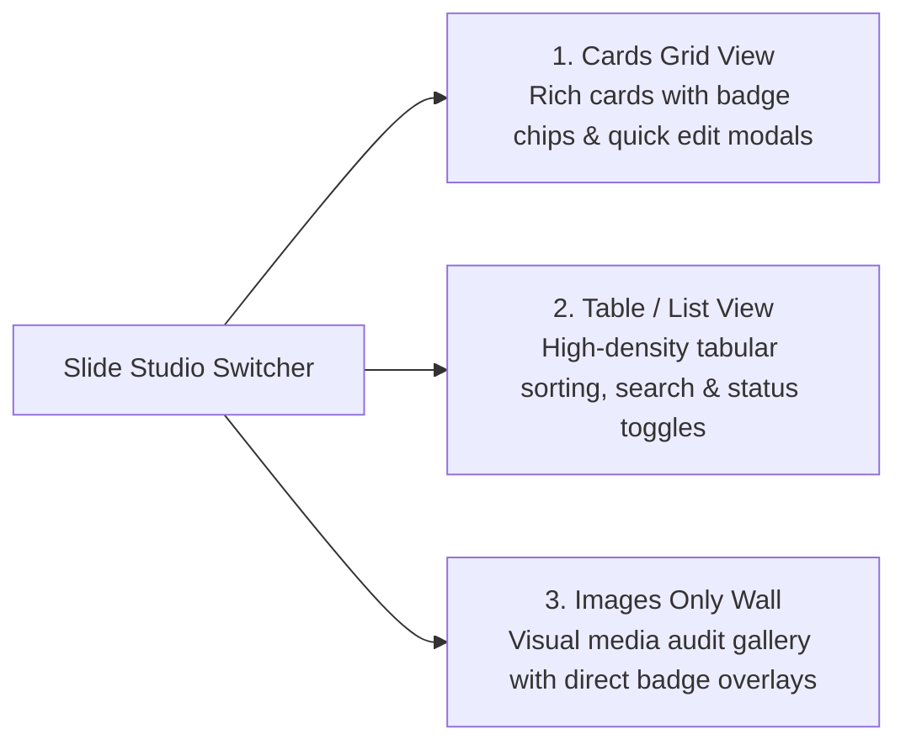

# Admin CMS Suite Specification

## Project: Silicon Real Estate Platform (Silicon City)
- **Base Route:** `/admin`
- **Target Users:** Non-technical marketing, sales, and operations personnel
- **Authentication:** Protected by `src/proxy.ts` and JWT cookie session

---

## 1. CMS Architecture & Navigation Structure

The Admin Suite provides a visual, real-time control room for managing every public facet of the website without editing code or running terminal commands.

```
/admin
├── Dashboard Overview (`page.tsx`)        # Inbound Leads, Inventory Stats, Quick Links
├── Slide Studio (`manage-slides/`)       # 3-Way Visual View for 3D Carousel Decks
├── Home Content (`home-settings/`)       # 8-Section Visual Manager & Landmark Cards
├── Plot Inventory (`inventory/`)         # Full Property CRUD with Katha & Prices
├── Leads CRM (`leads/`)                  # Inbound Client Pipeline (Status Kanban/Table)
├── About & Identity (`about-settings/`)  # Corporate Story, Mission, Vision, Milestones
├── Township Projects (`projects-settings/`)# Master Plan, Blueprint Specs, Roadmap
├── Citizen Services (`services-settings/`)# Legal Vetting, Boundary Demarcation Cards
├── Corporate HQ (`site-settings/`)       # Iqbal Road Address, Hotlines, Maps
└── Authentication (`login/`)             # Secure Login Portal
```

---

## 2. Multi-Format Hero Slide Studio (`/admin/manage-slides`)

The Slide Studio empowers editors to manage slides for the **3D Cylindrical Carousel** with an instant 3-way view switcher:



### Key Capabilities
- **Direct Order Sorting:** Numeric `order` field to arrange the sequence of rotation in the 3D cylinder.
- **Active / Inactive Toggle:** Instantly disable a slide from the live carousel without deleting it.
- **Dual Localization Fields:** English and Bengali titles, subtitles, and category badges.
- **Direct CDN Upload:** Integrated one-click file picker uploading directly to ImgBB CDN.

---

## 3. Dynamic Home Section Manager (`/admin/home-settings`)

Controls the 8 core sections of the landing page:

### 1. Progress Showcase Landmark Cards
- Manages the **5 Landmark Cards**:
  1. Grand Central Boulevard (৪০ ফুট প্রধান সড়ক)
  2. Central Jamia Mosque (কেন্দ্রীয় জামে মসজিদ)
  3. Riverfront Eco Park & Walkway (তুরাগ নদীতীরবর্তী গ্রিন পার্ক)
  4. Grand Athletics Sports Complex (প্রশস্ত খেলার মাঠ)
  5. Healthcare & School Zone (মেডিকেল ও শিক্ষা জোন)
- Allows one-click photo replacement via the `/api/upload` gateway.

### 2. Executive Leadership Studio
- Two-column split layout for the **Chairman** and **Managing Director**.
- High-resolution executive portrait upload with automatic initials fallback badge (`AK` / `SK`) if no image is present.
- Side-by-side textarea fields for formal English and Bengali leadership speeches.

### 3. Trust Counters & Accreditations
- Dynamic editing for key statistics (e.g., `150+ Acres`, `16-18 Ft Elevation`, `100% Mutation Ready`).
- Official regulatory compliance badges (RAJUK, Flood Embankment, Khatiyan).

---

## 4. Plot Inventory & Catalog Management (`/admin/inventory`)

- **Plot Specification Fields:**
  - Plot title and slug
  - Size in Katha and square feet
  - Category (Residential / Commercial / Industrial)
  - Price (Total BDT & price per Katha)
  - Availability status (`available`, `booked`, `sold`)
  - Feature tags (e.g., `Corner Plot`, `Facing 40ft Road`, `Lake View`)
- **Search & Filter:** Instant search by plot number, block, or status tag.

---

## 5. Inbound Leads CRM Pipeline (`/admin/leads`)

Monitors inquiries submitted through contact forms, plot detail modals, and offline membership inquiries.

### Lead Status Progression Workflow
```
[New Inquiry] ──▶ [Contacted] ──▶ [Qualified / Site Visit Scheduled] ──▶ [Closed / Handover]
```

### CRM Actions
- Filter leads by status (`new`, `contacted`, `qualified`, `closed`).
- One-click copy or direct dial for customer telephone and WhatsApp numbers.
- Mark lead notes and update progression stages.

---

## 6. Corporate Identity & Contact CMS (`site-settings`, `about-settings`)

- **Corporate Headquarters Details:** Edit Mohammadpur corporate office address, telephone numbers, secondary emails, and business hours.
- **Interactive Google Map:** Paste custom Google Maps embed URL directly into the CMS to update the map pin across contact pages.
- **Offline Membership Parameters:** Update the downloadable application form PDF URL (`formPdfUrl`), application fee (`BDT 1,000`), and office submission guidelines.
