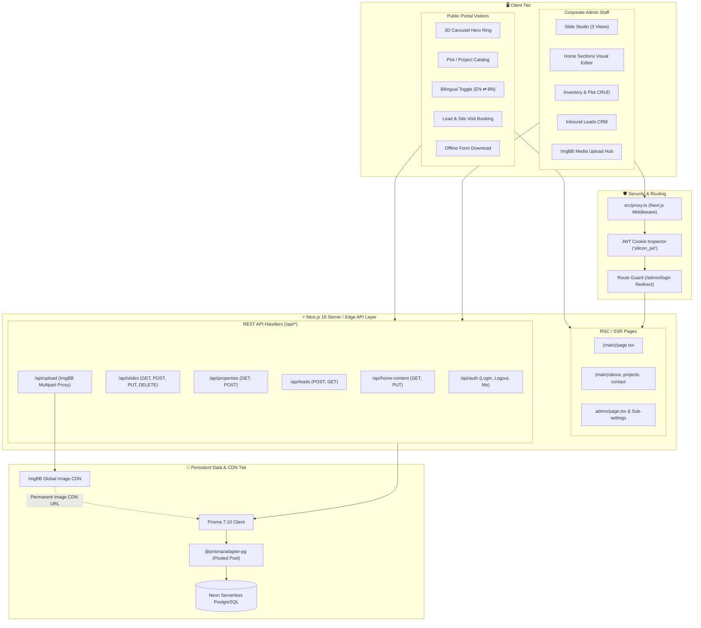
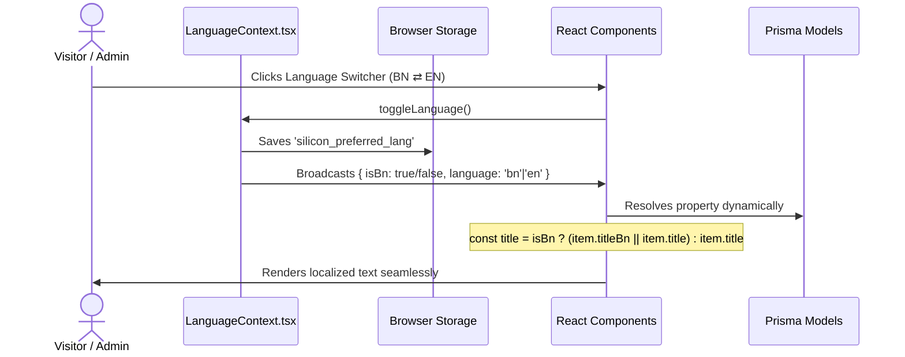

# System Architecture & Technical Design

## Project: Silicon Real Estate Platform (Silicon City)

- **Application Framework:** Next.js 16 (App Router)
- **Runtime Model:** Node.js (ESM) + Serverless PostgreSQL Edge Connection

---

## 1. High-Level Architectural Diagram

The Silicon Real Estate platform adopts a full-stack, decoupled architecture inside a unified Next.js 16 repository. Public users and internal administrators interact with distinct UI shells while sharing optimized API routes and database models.



---

## 2. Next.js 16 App Router Directory Breakdown

```
src/app/
├── (auth)/                    # Public auth redirects
├── (dashboard)/               # Alternate dashboard routes
├── (main)/                    # Public Front-Facing Experience
│   ├── layout.tsx             # Public Navbar, Footer, Providers
│   ├── page.tsx               # Master Landing Page (HomePageClient)
│   ├── about/                 # Corporate History & Leadership Speeches
│   ├── projects/              # Mega Township Sectors & Master Plan
│   ├── services/              # Legal land vetting, Registration, Handover
│   ├── contact/               # Corporate HQ, Hotline, Google Maps
│   └── privacy-terms/         # Legal terms & compliance policies
├── admin/                     # Enterprise No-Code Admin Suite
│   ├── layout.tsx             # Admin Navigation, Sidebar, User Session
│   ├── page.tsx               # Executive Overview & Lead Metrics Dashboard
│   ├── home-settings/         # Real-time editor for 8 home sections
│   ├── manage-slides/         # Multi-format 3D cylinder slide studio
│   ├── inventory/             # Plot catalog CRUD with Katha & pricing
│   ├── leads/                 # Lead CRM pipeline (new, contacted, qualified)
│   ├── about-settings/        # Corporate profile, mission, vision, milestones
│   ├── projects-settings/     # Township spotlights, amenities & roadmap
│   ├── services-settings/     # Service cards and pricing management
│   ├── site-settings/         # Corporate contact, hotlines & map embeds
│   └── login/                 # Secure administrative login portal
└── api/                       # REST API Route Handlers
    ├── auth/                  # JWT login, logout, session verification
    ├── home-content/          # Master landing page JSON configuration
    ├── slides/                # Hero carousel slide records
    ├── properties/            # Plot inventory records
    ├── leads/                 # Customer inquiry intake & CRM queries
    ├── upload/                # ImgBB image upload gateway
    ├── about-content/         # Corporate content endpoints
    ├── projects-content/      # Township spotlight endpoints
    ├── contact-info/          # HQ contact info endpoints
    ├── membership-content/    # Membership guidelines & PDF links
    └── seed/                  # Database seeder endpoint for default records
```

---

## 3. 3D Cylindrical Hero Carousel Architecture

The hero banner implements a cylindrical 3D carousel using **Framer Motion** (`src/components/home/glass/InteractiveCarouselRing.tsx`).

### Geometric Concept

- **Cylindrical Radius ($R$):** Dynamically computed based on the total number of active slides $N$ and slide card width $W$:
  $$\theta = \frac{2\pi}{N}, \quad R = \frac{W / 2}{\tan(\theta / 2)}$$
- **3D Transform:** Each slide item is translated along the Z-axis by $R$ and rotated along the Y-axis by its angular step:
  ```css
  transform: rotateY(angle) translateZ(radius);
  ```
- **Interaction Models:**
  1. **Continuous Orbit Mode:** Smooth auto-rotation using an animated frame ticker.
  2. **Interactive Drag Mode:** Captures pointer events (mouse drag or touch swipe) to dynamically adjust the rotational offset with spring physics.
  3. **Perspective Depth:** Rendered within a container with `perspective: 1200px` and `preserve-3d` for hyper-realistic spatial depth.

---

## 4. Bilingual Engine Architecture (Bangla ⇄ English)

The bilingual system operates with zero full-page reloads, ensuring instant localization across all pages:



### Key Architectural Safeguards

- **Graceful Fallbacks:** If the Bengali translation (`*Bn`) is null or unpopulated in the database, the component automatically falls back to the master English string.
- **HTML Document Sync:** Automatically updates `document.documentElement.lang = 'bn'` and `data-lang="bn"` for correct typography and screen reader accessibility.

---

## 5. Security & Authentication Middleware Architecture

Administrative access is protected through a two-stage security perimeter:

### Stage 1: Edge Proxy (`src/proxy.ts`)

- Configured with matcher: `matcher: ["/admin/:path*"]`.
- Inspects incoming request cookies for `silicon_jwt`, `silicon_jwt_token`, or `token`.
- Unauthenticated requests targeting `/admin` (except `/admin/login`) are redirected immediately to `/admin/login`.
- Authenticated requests attempting to visit `/admin/login` are redirected forward to `/admin`.

### Stage 2: Server-Side JWT Verification (`src/lib/server-auth.ts`)

- API routes execute `verifyAdminSession(req)` before processing any destructive action (POST, PUT, DELETE).
- Verifies JWT digital signatures using `JWT_SECRET`.
- Auto-seeds a default admin account (`admin@siliconrealestatepvtltd.com`) on startup if no records are found in the `Admin` model.

---

## 6. Media Cloud Pipeline (ImgBB CDN)

Direct browser-to-cloud uploads can expose private API keys. The Silicon platform proxies image uploads through a secure server-side route handler:

```
[Admin UI File Drop / Camera Input]
         │
         ▼ (Multipart / FormData)
[POST /api/upload]  <── Authenticated via JWT Session Cookie
         │
         ├── 1. Validates Admin Session
         ├── 2. Converts Image Stream to Base64 Buffer
         ├── 3. Attaches IMGBB_API_KEY
         ▼ (x-www-form-urlencoded)
[ImgBB Cloud API: https://api.imgbb.com/1/upload]
         │
         ▼
[Returns Direct Permanent URL: https://i.ibb.co/xxxxx/image.jpg]
         │
         ▼
[Saves CDN URL into PostgreSQL via Prisma]
```

---

## 7. Database Connection Pooling Architecture

To handle serverless connections efficiently without exhausting PostgreSQL connection limits:

- Built with **Neon Serverless PostgreSQL**.
- Utilizes `pg.Pool` initialized with:
  ```ts
  new Pool({
    connectionString,
    max: 10,
    idleTimeoutMillis: 30000,
  });
  ```
- Wrapped with `@prisma/adapter-pg` to provide native Prisma Client integration without cold-start connection latency.
- Global singleton instance maintained in `src/lib/prisma.ts` to prevent duplicate connection pools during Next.js Hot Module Replacement (HMR).
